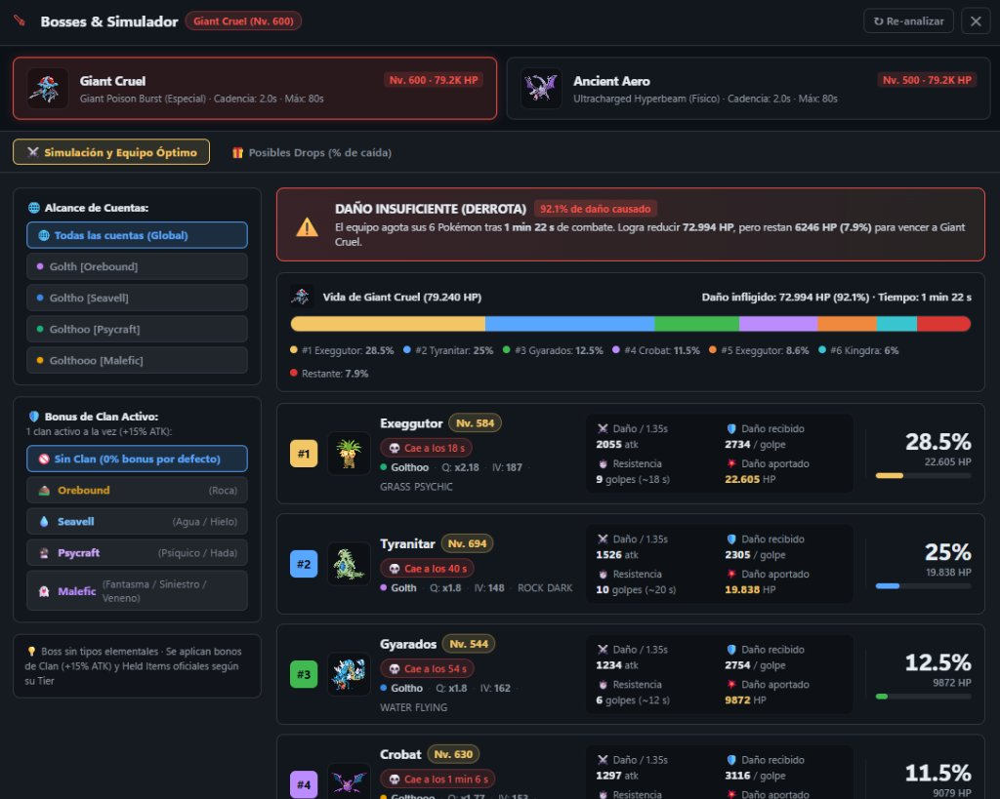
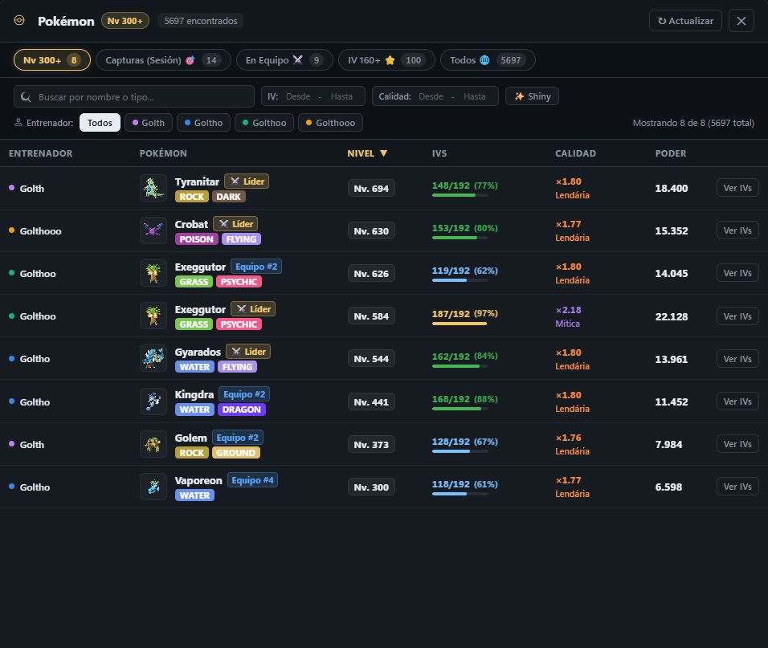
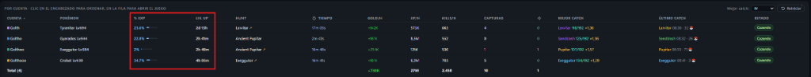
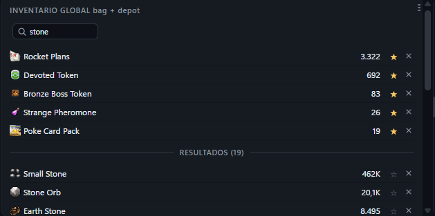
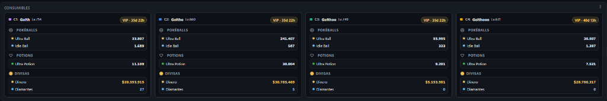
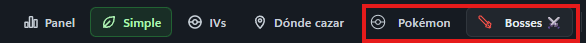

<div align="center">


# PokeGrid (Extended Edition)

**Up to four Poke Idle World accounts in a single window, with advanced analytical tools.**


[](LICENSE)

[Español](README.md)


<sub>Simple mode: hides the game to reduce CPU usage and displays real-time metrics. Every section can be moved and resized.</sub>

</div>

> ℹ️ **Enhanced Fork:** This project is a fork of [PokeGrid-source](https://github.com/soufoka/PokeGrid-source) created by [soufoka](https://github.com/soufoka). It preserves the lightweight, safe and modular architecture of the original software while introducing an exclusive analytical suite: Boss Simulator & Team Optimizer, Global Multi-Account Pokémon Explorer, real-time EXP % and Lvl Up projections, Smart Inventory with pinned favorites, and modular supplies tracking.

> This is the run-from-source version. There is no opaque executable: you download the code, audit exactly what it does, and run it yourself with full transparency.

> 🔰 **First time running it?** Check out the step-by-step guide: **[TUTORIAL.md](TUTORIAL.md)** (or the `COMO USAR.txt` file inside the folder).

> ### 🔒 Your login data stays only on your computer
> Usernames and passwords are encrypted on your local PC using Electron's secure `safeStorage` API (DPAPI on Windows) and never leave your machine. No external servers, no telemetry, no remote repositories.

## What is PokeGrid?

Four accounts running at once, each in its own quadrant with a completely isolated session. You save the login once and the app signs in automatically on every launch. If a session drops mid farm (network drops, server restarts), the manager reconnects automatically without requiring you to sit in front of the screen.

*It does not automate in-game actions or solve captchas:* it only organizes, protects, and optimizes the performance of your existing accounts.

## 🚀 Exclusive New Features & Enhancements

This custom version incorporates powerful analytical tools, advanced simulators, and quality-of-life (QoL) improvements designed to elevate multi-account gameplay:

---

### 1. ⚔️ Boss Simulator & Team Optimizer
Simulates full battles against world bosses (**Giant Cruel**, **Ancient Aero**, and future bosses) with mathematical precision.



- **Accurate Combat Simulation**: Accurately models damage per hit, attack cadence, survival endurance of each Pokémon, and total team survival time.
- **Ergonomic Two-Column Layout**:
  - **Configuration Sidebar**: Scope selection ("All accounts" Global mode or individual trainer), dynamic Clan Bonus selector (+15% ATK) with official elemental affinities (Orebound, Seavell, Psycraft, Malefic, Naturia, etc.), and official Held Item badges.
  - **Main Combat Dashboard**: Battle outcome banner (Victory or Defeat with boss remaining HP), segmented multi-color health bar, and 1 Pokémon per row display with 2x2 combat metrics and rightmost prominent % boss damage box.
- **Official Held Items Calibrated by Tiers**: Full calibration of official game Held Item tiers (Tiers 1 to 8 for X-Attack, X-Defense, X-Vitality, X-Boost, Critical, Block, Experience, and Lucky).
- **Automatic Team Optimization**: Analyzes all Pokémon across all your accounts and automatically suggests the optimal 6-member team to defeat the boss.

---

### 2. 🔍 Global Multi-Account Pokémon Explorer
A unified modal dashboard to inspect and search all Pokémon across all connected accounts.



- **Instant Preset Filters with Live Counts**:
  - `Lv 300+`: Quick access to high-level Pokémon.
  - `Catches (Session)`: Pokémon caught during the active session.
  - `In Team`: All Pokémon currently assigned to combat teams.
  - `IV 160+`: High IV Pokémon.
  - `All`: Complete census across all accounts.
- **Combined Advanced Filters**: Filter by name or elemental type, IV ranges (Min - Max), Quality multiplier ranges, Shiny toggle ✨, and specific trainer selector.
- **Weighted Total Power Formula**: Calculates effective power index combining level, IVs, and quality/rarity multiplier.
- **Instant IV Inspection**: One-click modal to inspect detailed IV distribution and stats.

---

### 3. 📊 % EXP Progress & Real-Time Lvl Up Estimation
See exact level progress and remaining time for each account's team leader.



- **% EXP**: Exact percentage accumulated in the current level with an integrated visual progress bar.
- **Lvl Up**: Real-time smart time projection (`2h 41m`, `2d 15h`) calculated dynamically from the active hunt's XP/h rate.

---

### 4. ⭐ Global Inventory with Pinned Favorites & Live Search
Unified inventory aggregating bag and depot resources from all active accounts.



- **Persistent Favorites**: Click the star `☆` on any item to pin it to the top with a gold `★`, keeping it visible regardless of quantity or sort order.
- **Visual Divider Bar**: Clean separator between pinned favorites and search results or other items.
- **Real-Time Search**: Instant filtering while typing without resets during automatic card refresh ticks.

---

### 5. 🎒 Modular Consumables, Currency & VIP Card
Compact overview of essential resources per account without needing to switch windows.



- **Pokéballs**: Live count per account of Ultra Balls, Idle Balls, and others.
- **Potions**: Stock of Ultra Potions and healing items.
- **Currencies**: Accumulated Gold ($) and Diamonds per account.
- **VIP Status & Time**: Badge displaying active VIP membership and exact remaining time (`VIP · 35d 22h`).

---

### 6. ⚡ Topbar Shortcuts & Hot UI Reload
Smooth navigation without interrupting running game sessions.



- **Topbar Module Buttons**: Direct buttons for **Pokémon** and **Bosses ⚔️** with quick `Escape` key close support.
- **Hot Reload UI Button**: Refresh visual enhancements and scripts in live mode without reloading `<webview>` panels.

---

## How to run

You need Node.js installed once. After that it is quick.

**1. Install Node.js**  
Download the LTS version at [nodejs.org](https://nodejs.org) and install it.

**2. Download this code**  
Click the green **Code** button above and then **Download ZIP**, or clone using Git:

```bash
git clone https://github.com/cesargarma/PokeGrid-source.git
```

**3. Open the app**  
- **On Windows:** Double click **Abrir PokeGrid** (`.bat`) in the folder. The first time it installs dependencies in a console window and opens the app; subsequent launches start immediately. To create a desktop shortcut: Right click -> **Send to: Desktop (create shortcut)**.
- You can also use **iniciar.bat**, which keeps the terminal window open while running.
- **On macOS or Linux:** Open a terminal in the project folder and run:

```bash
bash iniciar.sh
```

Log in to each quadrant and save credentials under "Treinadores" (Accounts) to enable auto-login for future launches.

## Documentation

| Link | Description |
|---|---|
| **[Manual](MANUAL.md)** | Detailed guide for every button, panel, and card |
| **[FAQ](FAQ.md)** | Frequently asked questions: non-destructive updates, scripts, troubleshooting |
| **[Tutorial](TUTORIAL.md)** | Step-by-step walkthrough for non-technical users |
| **[Changelog](CHANGELOG.md)** | Version history and release notes |

## Key Features

- **Flexible Multi-Account**: Run 1 to 4 accounts independently based on your needs.
- **Persistent Auto-Login**: Automatic background re-authentication on session drops or game disconnects.
- **Smart Eco Mode**: Drastically reduces CPU and GPU usage by throttling rendering during background farming.
- **Clean Game Interface**: Hides web chat and native game menus to maximize visible farming space.
- **Audio & Discord Webhook Alerts**: Immediate alerts for shiny encounters, account disconnects, or low supplies on Windows and Discord.
- **Granular Controls**: Individual zoom, full-screen toggles, selective mute, and hotkeys.
- **OS Integration**: System tray support, auto-start with Windows, and multi-language support (Spanish, English, and Portuguese).

## Security & Privacy

- **Local Encryption**: Credentials are encrypted using the operating system's native API via Electron's `safeStorage` (DPAPI on Windows). They never leave your PC.
- **Sandboxed Panels**: Panels are locked to the game domain. External links open in your default browser, and credentials only interact with official login inputs.
- **Restricted Webview Permissions**: Camera, microphone, geolocation, and browser notifications are blocked.
- **100% Manual Captchas**: PokeGrid autofills saved credentials but never attempts to solve or bypass bot detection challenges ("Confirm you are human").

## Under the Hood

Each quadrant runs in an independent Electron `<webview>` with its own isolated partition (`persist:conta1` to `persist:conta4`), ensuring complete session isolation.

The live UI extension layer (`src/custom-ui.js`) dynamically mounts enhanced analytical modals, tables, and views without altering Electron's core, enabling seamless hot-reloads during active gameplay.

## Credits & Acknowledgements

- **Original Project**: This software is an enhanced fork of **[PokeGrid](https://github.com/soufoka/PokeGrid-source)**, created by **[soufoka](https://github.com/soufoka)**. Huge thanks to soufoka for the initial design and architecture.
- **Fork & Extensions**: Developed and maintained by **[cesargarma](https://github.com/cesargarma/PokeGrid-source)** with custom combat simulations, team optimizer, global inventory, and multi-account analytics.

## License

Distributed under the MIT License. Independent project not affiliated with Pokémon or Poke Idle World.
