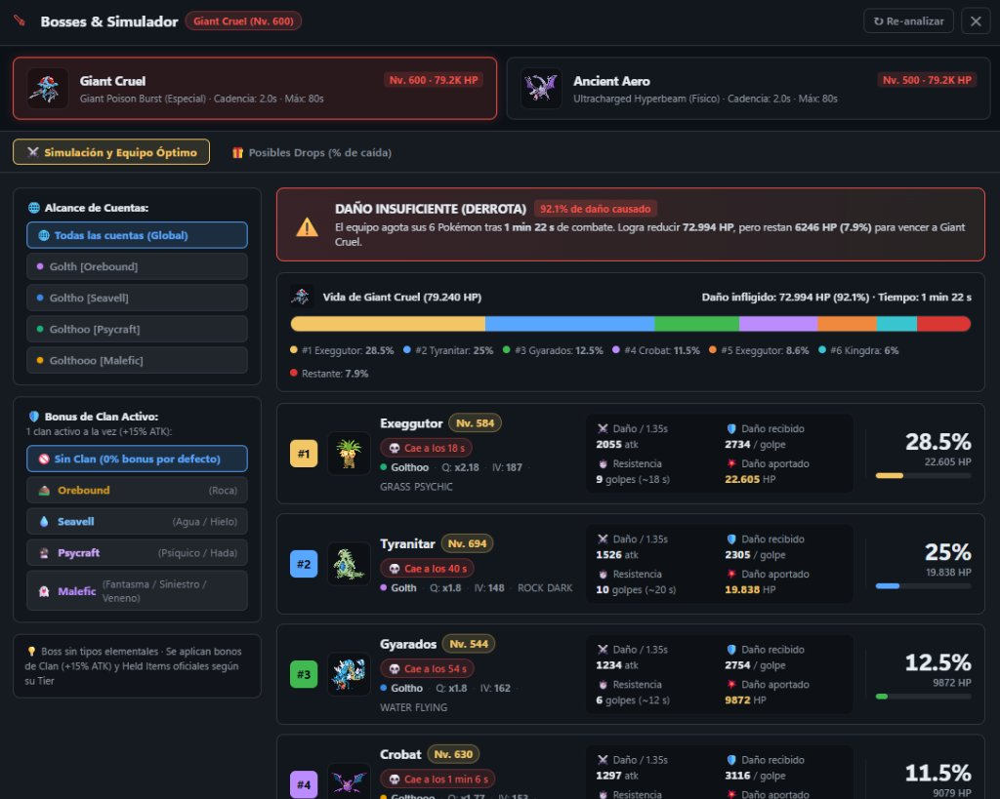
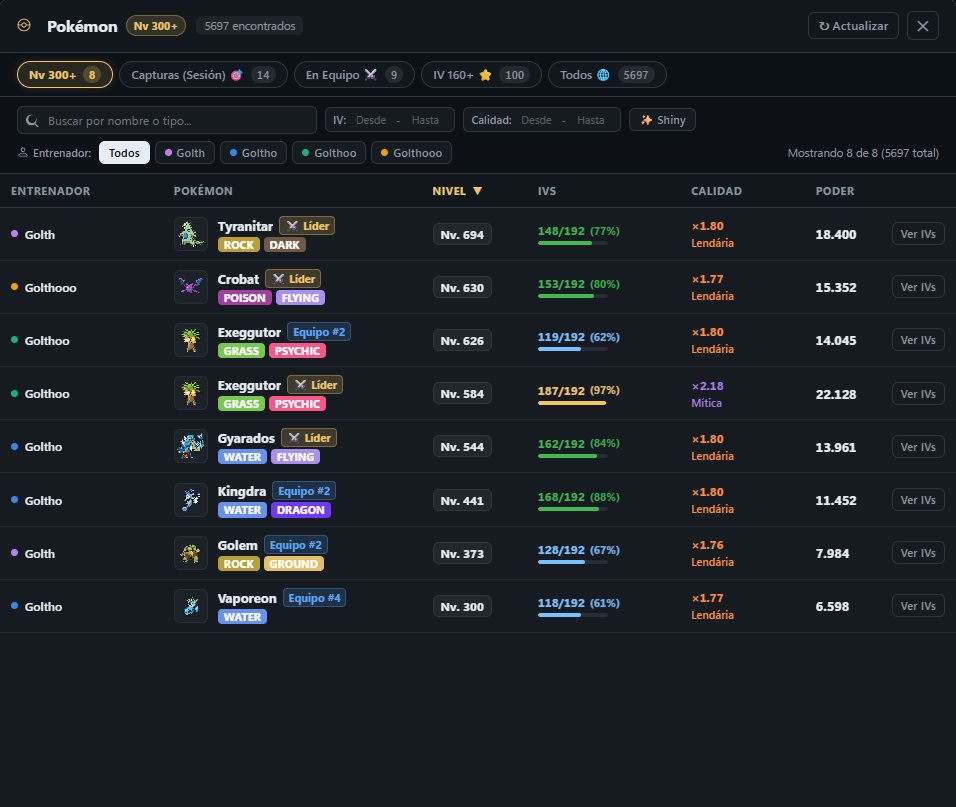
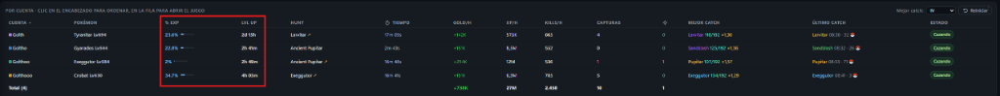
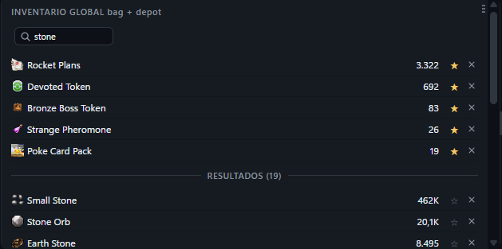
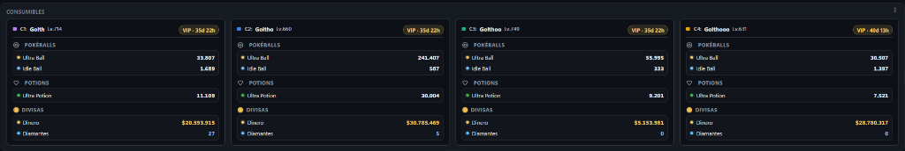
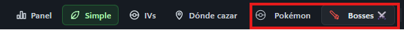

<div align="center">


# PokeGrid (Extended Edition)

**Hasta cuatro cuentas de Poke Idle World en una sola ventana, con herramientas analíticas avanzadas.**


[](LICENSE)

[English](README.en.md)


<sub>Modo Simple: oculta el juego para minimizar el uso de CPU y muestra métricas detalladas en tiempo real. Cada sección se puede mover y redimensionar.</sub>

</div>

> ℹ️ **Fork Mejorado:** Este proyecto es un fork de [PokeGrid-source](https://github.com/soufoka/PokeGrid-source) desarrollado originalmente por [soufoka](https://github.com/soufoka). Mantiene toda la arquitectura segura, ligera y modular del proyecto original, incorporando una suite exclusiva de herramientas avanzadas: Simulador y Optimizador de Bosses, Explorador Global de Pokémon multicuenta, cálculo de progreso de EXP y tiempo de Lvl Up, Inventario inteligente con favoritos persistentes y tarjeta modular de consumibles.

> Esta es la versión que se ejecuta directamente desde el código fuente. No hay ejecutables opacos: descargas el código, puedes auditar exactamente lo que hace y ejecutarlo tú mismo con total confianza y transparencia.

> 🔰 **¿Primera vez usándolo?** Tienes una guía paso a paso aquí: **[TUTORIAL.md](TUTORIAL.md)** (o en el archivo `COMO USAR.txt` dentro de la carpeta).

> ### 🔒 Tus datos de acceso permanecen únicamente en tu ordenador
> Los nombres de usuario y contraseñas se almacenan cifrados en tu propio PC utilizando el sistema seguro de Electron (`safeStorage` / DPAPI en Windows) y nunca salen de él. Sin servidores externos, sin telemetría ni repositorios remotos.

## ¿Qué es PokeGrid?

PokeGrid permite ejecutar hasta cuatro cuentas de Poke Idle World de forma simultánea, cada una en su propio cuadrante y con sesión totalmente independiente. Guardas las credenciales una sola vez y la aplicación inicia sesión automáticamente en cada inicio. Si una sesión se interrumpe durante el farmeo (caídas de red, reinicios del servidor), el gestor reconecta automáticamente sin necesidad de que estés pendiente frente a la pantalla.

*No automatiza acciones dentro del juego ni resuelve captchas:* únicamente organiza, protege y optimiza el rendimiento de tus cuentas existentes.

## 🚀 Novedades y Mejoras Exclusivas

Esta versión personalizada incorpora potentes herramientas analíticas, simuladores avanzados y mejoras de calidad de vida (QoL) desarrolladas para llevar el rendimiento multicuenta al siguiente nivel:

---

### 1. ⚔️ Simulador de Bosses & Optimizador de Equipos
Permite simular batallas completas contra los jefes mundiales del juego (**Giant Cruel**, **Ancient Aero** y futuros bosses) calculando con precisión matemática el desenlace del combate.



- **Simulación precisa de combate**: Modela el daño por golpe, tiempo de ataque (cadencia), aguante individual de cada Pokémon y tiempo total de supervivencia frente al boss.
- **Diseño ergonómico en dos columnas**:
  - **Panel lateral de configuración**: Selección de alcance (modo global "Todas las cuentas" o individual por entrenador), selector dinámico de bonus de Clan (+15% ATK) con afinidades elementales oficiales (Orebound, Seavell, Psycraft, Malefic, Naturia, etc.), e indicadores de Held Items.
  - **Panel principal de resultados**: Banner de resultado (Victoria o Derrota con HP restante del boss), barra de vida segmentada por el daño causado por cada Pokémon, y visualización de un Pokémon por fila con métricas 2x2 (Daño / cadencia, Daño recibido / golpe, Resistencia en golpes/tiempo, Daño aportado) y porcentaje de daño destacado.
- **Held Items oficiales calibrados por Tiers**: Soporte fiel a la tabla oficial de Held Items (Tiers 1 al 8 para X-Attack, X-Defense, X-Vitality, X-Boost, Critical, Block, Experience y Lucky).
- **Optimización y selección automática**: Analiza todos los Pokémon disponibles entre tus cuentas y compone automáticamente el equipo óptimo de 6 para maximizar el DPS y la probabilidad de victoria.

---

### 2. 🔍 Explorador Global de Pokémon Multicuenta
Unifica en una única pantalla de consulta rápida todos los Pokémon que posees repartidos en cualquiera de tus cuentas.



- **Presets instantáneos con contadores en tiempo real**:
  - `Nv 300+`: Acceso directo a los Pokémon de alto nivel.
  - `Capturas (Sesión)`: Pokémon capturados en la sesión activa de juego.
  - `En Equipo`: Todos los Pokémon actualmente asignados a equipos de combate.
  - `IV 160+`: Ejemplares con estadísticas genéticas sobresalientes.
  - `Todos`: Censo total de Pokémon entre todas las cuentas.
- **Filtros avanzados combinables**: Búsqueda por nombre o tipo elemental, rangos de IVs mínimos y máximos, rangos de calidad multiplicadora, filtro de Shinies ✨ y selector por entrenador.
- **Cálculo de Poder Total ponderado**: Algoritmo que calcula el poder efectivo combinando nivel, IVs y multiplicador de calidad/rareza (Lendária, Mítica, etc.).
- **Inspección de IVs**: Acceso al desglose de IVs y estadísticas detalladas con un solo clic.

---

### 3. 📊 Columnas de % EXP y Estimación de Lvl Up en la Tabla Simple
Visualiza al instante el progreso exacto y el tiempo restante para que el líder de cada cuenta suba de nivel.



- **% EXP**: Muestra el porcentaje acumulado en el nivel actual con una barra de progreso gráfica proporcional.
- **Lvl Up**: Proyección temporal inteligente en tiempo real (`2h 41m`, `2d 15h`) calculada a partir del ritmo medido de XP/hora en la hunt en curso.

---

### 4. ⭐ Inventario Global con Favoritos Fijados y Búsqueda en Vivo
Gestión de inventario unificada que suma los recursos de bolsa y depósito de todas las cuentas activas.



- **Sistema de Favoritos persistente**: Marca cualquier ítem con la estrella `☆` para fijarlo arriba del todo con `★` dorado, manteniéndolo siempre a la vista sin importar la cantidad o el orden alfabético.
- **Separador visual elegante**: Barra divisoria que delimita los favoritos fijados de los demás ítems o resultados de búsqueda.
- **Buscador en tiempo real persistente**: Filtra al instante mientras escribes, con persistencia garantizada que evita parpadeos o reinicios involuntarios durante los ciclos de refresco automático del juego. Los favoritos siempre permanecen fijados arriba.

---

### 5. 🎒 Tarjeta Modular de Consumibles, Divisas y Estado VIP
Panel unificado y compacto para monitorizar los suministros esenciales de cada cuenta sin necesidad de entrar a cada juego.



- **Pokéballs**: Recuento por cuenta de Ultra Balls, Idle Balls y otras bolas en uso.
- **Pociones**: Stock de pociones (Ultra Potion, etc.) para prevenir muertes innecesarias en el farm.
- **Divisas**: Dinero acumulado ($) y Diamantes en tiempo real por cuenta.
- **Estado y tiempo VIP**: Indicador visual del estado de membresía VIP con el tiempo restante exacto (`VIP · 35d 22h`).

---

### 6. ⚡ Accesos Rápidos en Barra Superior y Recarga en Caliente
Navegación cómoda y fluida sin interferir con las partidas en ejecución.



- **Botones dedicados en la Topbar**: Accesos directos para abrir los modales de **Pokémon** y **Bosses ⚔️** con tecla rápida `Escape` para cerrar.
- **Botón "Recargar UI"**: Permite recargar las mejoras visuales y scripts personalizados en caliente sin recargar los `<webview>` ni interrumpir el farmeo de las cuentas.

---

## Cómo ejecutar

Solo necesitas tener Node.js instalado una vez. A partir de ahí es inmediato.

**1. Instala Node.js**  
Descarga la versión LTS desde [nodejs.org](https://nodejs.org) e instálala con las opciones por defecto.

**2. Descarga este repositorio**  
Haz clic en el botón verde **Code** arriba a la derecha y pulsa **Download ZIP**, o clona mediante Git:

```bash
git clone https://github.com/cesargarma/PokeGrid-source.git
```

**3. Inicia la aplicación**  
- **En Windows:** Haz doble clic en el archivo **Abrir PokeGrid** (`.bat`) en la raíz de la carpeta. La primera vez instalará automáticamente las dependencias necesarias y abrirá la aplicación; en las siguientes aperturas iniciará de forma instantánea. Puedes crear un acceso directo en tu Escritorio haciendo clic derecho -> **Enviar a: Escritorio (crear acceso directo)**.
- También dispones de **iniciar.bat**, el cual mantiene la consola de comandos abierta mientras se ejecute.
- **En macOS o Linux:** Abre una terminal en la carpeta del proyecto y ejecuta:

```bash
bash iniciar.sh
```

Una vez abierta la interfaz, inicia sesión con tus cuentas en cada cuadrante y guárdalas en el menú "Treinadores" (Entrenadores) para que inicien automáticamente en el futuro.

## Documentación

| Enlace | Descripción |
|---|---|
| **[Manual](MANUAL.md)** | Guía detallada de cada botón, panel y sección |
| **[FAQ](FAQ.md)** | Preguntas frecuentes: actualizaciones sin perder datos, scripts, resolución de incidencias |
| **[Tutorial](TUTORIAL.md)** | Guía paso a paso para usuarios sin experiencia técnica |
| **[Cambios](CHANGELOG.md)** | Historial de versiones y notas de desarrollo |

## Funcionalidades principales

- **Control multicuenta flexible**: Ejecuta de 1 a 4 cuentas de forma independiente según tus necesidades.
- **Auto-login persistente**: Reconexión automática transparente ante desconexiones o expiraciones de sesión.
- **Modo Eco inteligente**: Reduce el consumo de CPU y GPU ralentizando el renderizado sin perjudicar el ritmo de captura y farmeo.
- **Optimización de pantalla**: Oculta el chat y los menús de la interfaz web del juego para maximizar el área visible.
- **Sistema de alertas sonoras y webhook**: Notificaciones instantáneas al encontrar shinies, caídas de cuenta o falta de suministros, tanto en Windows como vía Discord Webhooks.
- **Control granular**: Controles de zoom, pantalla completa, silenciado selectivo y atajos de teclado rápidos.
- **Integración con el sistema**: Bandeja del sistema (tray), inicio con Windows y soporte multilingüe (español, inglés y portugués).

## Seguridad y Privacidad

- **Cifrado local seguro**: Las contraseñas están protegidas por la API nativa del sistema operativo a través de `safeStorage` de Electron (DPAPI en Windows). Nunca se transmiten fuera de tu máquina.
- **Sandboxing de paneles**: Las sesiones están estrictamente restringidas al dominio del juego. Cualquier enlace externo se abre en tu navegador predeterminado y las credenciales solo interactúan con los formularios legítimos de login.
- **Permisos restringidos**: Cámara, micrófono, geolocalización y notificaciones del navegador web permanecen bloqueados.
- **Captcha 100% manual**: PokeGrid rellena tus credenciales guardadas, pero nunca resuelve ni elude las verificaciones anti-bot ("Confirma que eres humano"). La resolución de captchas siempre es potestad del usuario.

## Arquitectura interna

Cada cuadrante se ejecuta en un `<webview>` independiente de Electron con su propia partición aislada (`persist:conta1` a `persist:conta4`), garantizando que las cookies y el almacenamiento local permanezcan estancos. 

La capa de extensión en vivo `src/custom-ui.js` inyecta de forma dinámica las mejoras visuales, tablas interactivas y modales analíticos sin alterar el núcleo de Electron, permitiendo recargar la interfaz en caliente sin cerrar ni reiniciar las partidas en curso.

## Créditos y Reconocimientos

- **Proyecto Original**: Este software es un fork mejorado de **[PokeGrid](https://github.com/soufoka/PokeGrid-source)**, creado por **[soufoka](https://github.com/soufoka)**. Agradecemos su excelente trabajo en la concepción y arquitectura base de la aplicación.
- **Fork y Extensiones**: Desarrollado y mantenido por **[cesargarma](https://github.com/cesargarma/PokeGrid-source)** con nuevas herramientas de combate, optimización de equipo, inventario inteligente y análisis multicuenta.

## Licencia

Distribuido bajo licencia MIT. Proyecto independiente sin afiliación oficial con Pokémon ni Poke Idle World.
